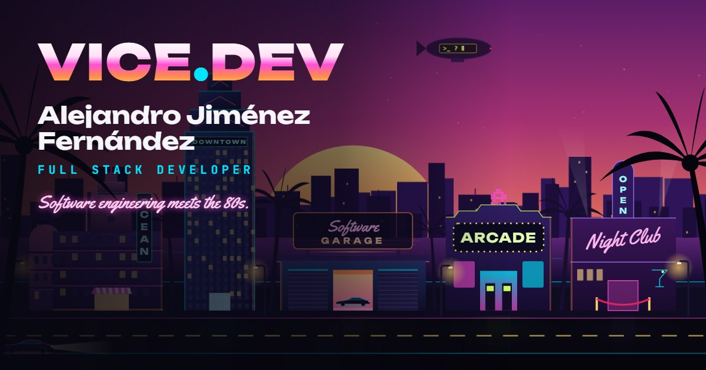

# VICE.DEV — A Developer After Dark

Portfolio de **Alejandro Jiménez Fernández**, desarrollador Full Stack en Sevilla.
Una ciudad tropical de los 80, dibujada a mano en SVG, donde cada edificio es una sección del portfolio.

**🌴 https://alejmnz0.github.io/**



## Qué hay dentro

| Lugar | Sección | Ruta |
|---|---|---|
| 01 · Ocean Drive | About me | `/about/` |
| 02 · Downtown | Experience | `/experience/` |
| 03 · Software Garage | Projects | `/projects/` |
| 04 · Arcade | Skills & Experiments | `/skills/` |
| 05 · Night Club | Contact | `/contact/` |

- **Intro cinematográfica** solo en la primera visita de la sesión a `/` (se puede saltar con el botón o `Esc`; nunca en enlaces directos).
- **Navegación híbrida**: mapa explorable + menú convencional (barra superior en escritorio, menú a pantalla completa en móvil) + directorio de la ciudad bajo el mapa.
- **Móvil y tablet**: diseño propio (hero con la calle de los cinco edificios + postales táctiles) en lugar del mapa panorámico.
- **Modo Sunset / Midnight** (botón luna/sol), guardado por visitante.
- **Vice Radio**: synthwave generativo creado en el navegador con Web Audio API. Sin archivos de audio, sin licencias, nunca suena sola.
- **Easter eggs**: la terminal (tecla <kbd>`</kbd>, el dirigible del cielo o el enlace "¿terminal?" del pie) y el código ↑↑↓↓←→←→BA.

## Stack y decisiones

| Pieza | Por qué |
|---|---|
| React 19 + TypeScript + Vite | Pedido en el brief; build rápido y tipado estricto. |
| React Router 7 | Rutas reales (`/about/`, `/projects/`…) enlazables por recruiters. |
| **Prerender propio** (`scripts/prerender.mjs`) | Cada ruta se genera como HTML estático en el build: SEO real, Open Graph por página y primer pintado sin esperar al JS. Luego React hidrata. |
| CSS Modules + tokens en `src/styles/global.css` | Estilos encapsulados, sin runtime. |
| **Ilustración SVG + animaciones CSS** (sin Three.js ni Framer Motion) | La ciudad es 2D por capas con parallax. Todo lo que se anima es `transform`/`opacity` en CSS, así que no hace falta una librería de animación: menos JS y `prefers-reduced-motion` se respeta con una sola regla. |
| lucide-react | Iconos (tree-shaken). Los logos de GitHub/LinkedIn son SVG propios porque lucide v1 retiró las marcas. |
| Fuentes Fontsource (Unbounded, Manrope, JetBrains Mono, Yellowtail) | Autoalojadas, sin peticiones a terceros; las dos principales se precargan. |
| Playwright | Pruebas responsive (9 anchos × 6 rutas) y de funcionalidad. |

## Desarrollo

Requisitos: Node 20.19+ (probado con Node 24).

```bash
npm install
npm run dev        # http://localhost:5173
npm run check      # TypeScript + ESLint
npm run build      # build de cliente + SSR + prerender → dist/
npm run preview    # sirve dist/ en http://localhost:4173
npm test           # Playwright (arranca preview si no está corriendo)
```

La primera vez que ejecutes las pruebas: `npx playwright install chromium`.

## Cómo modificar el contenido

Todo el contenido vive en **`src/data/`**. Los componentes solo leen de ahí.

| Quiero cambiar… | Archivo |
|---|---|
| Nombre, titular, bio, especialización, idiomas | `src/data/profile.ts` |
| Experiencia laboral | `src/data/experience.ts` |
| Proyectos | `src/data/projects.ts` |
| Tecnologías | `src/data/skills.ts` |
| Formación | `src/data/education.ts` |
| Email, GitHub, LinkedIn | `src/data/social.ts` |
| Títulos y descripciones SEO por página | `src/config/site.ts` |
| Nombres de los lugares de la ciudad | `src/config/locations.ts` |

### Añadir un proyecto

1. Copia un objeto en `src/data/projects.ts` y dale un `id` y `plate` únicos (`'AJ·07'`).
2. Rellena `description`, `problem`, `role`, `features`, `tech` y `repo`. `status` puede ser `active`, `completed`, `academic` o `experiment`. `featured: true` lo muestra a ancho completo.
3. Capturas (opcional): guárdalas en `public/projects/` como WebP de ~1280 px de ancho y añádelas a `images`. Sin capturas se genera una portada automática con el color `hue`.

Las skills se enlazan solas con experiencia y proyectos: si una tecnología aparece en `tech`, el Arcade lo mostrará como "Desbloqueado en".

### Cambiar imágenes

- **Foto personal**: deja la imagen en `public/img/` (p. ej. `me.webp`, cuadrada, ~440 px) y pon `photo: '/img/me.webp'` en `profile.ts`. Con `null` se muestra el monograma.
- **Imagen para compartir (LinkedIn/Twitter)**: `public/og-image.jpg` (1200×630). Para regenerarla desde la ciudad real: `npm run build && npm run preview` y, en otra terminal, `node scripts/make-images.mjs` (también regenera los iconos PNG a partir de `public/favicon.svg`).

### Actualizar el CV

Sustituye `public/cv/CV_Alejandro_Jimenez_Fernandez.pdf` por el nuevo PDF (mismo nombre) y actualiza `cv.updated` en `profile.ts`. Si cambias el nombre del archivo, actualiza también `cv.href` y `cv.fileName`.

## Publicar cambios

Haz push a `main`. GitHub Actions (`.github/workflows/deploy.yml`) instala dependencias, pasa TypeScript + ESLint, compila y prerenderiza, ejecuta Playwright y, si todo pasa, publica `dist/` en GitHub Pages. Si una prueba falla no se publica nada y el informe queda como artefacto del workflow.

Configuración única del repositorio: *Settings → Pages → Source: GitHub Actions*.

## Estructura

```
src/
  data/          contenido profesional (única fuente de verdad)
  config/        SEO por ruta y lugares de la ciudad
  components/
    city/        ciudad SVG: edificios, palmeras, coches, mapa interactivo
    intro/       secuencia de entrada
    layout/      navegación, cabecera de sección, pie
    projects/    portadas generadas
    radio/       Vice Radio (motor Web Audio cargado bajo demanda)
    easter/      terminal y código Konami
  pages/         una página por sección
  entry-server.tsx  render para el prerender
scripts/         prerender, capturas e imágenes
tests/           Playwright
docs/            origen de los datos y conciliación CV/LinkedIn
```

## Créditos

Diseño, ilustraciones, logotipo y música generativa originales. Inspirado en la estética de Miami en los 80; no usa logotipos, personajes, mapas, música ni recursos de ningún videojuego.
